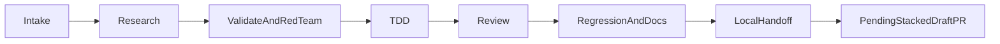

# Issue 24 execution ledger

Status: Local implementation and verification in progress; publication and acceptance pending.

## Authority and provenance

The owner-development amendment supersedes the historical #17 development gate only. The owner's delegated engineering decisions are recorded in ADR 0008 and the R2 recovery contract. Only #24 storage/schema and strictly necessary compatibility work are assigned. No successor domain commands, V2 recovery, merge, deployment or provisioning are authorized.

Published issue plan is preserved byte-for-byte from correction commit `aa2bc102700cfd3216d24991b24766a693015568`, blob `59f74befdd2162059d9956e12589e18368b1412b`. Current execution notes supersede its historical readiness/decision language, not its immutable evidence.

Local isolated clone: `git clone --no-hardlinks /tmp/r2-023-local/repo /tmp/r2-024-local/repo`; origin removed. Base `3ea0fbf9a2d541919b611ac1e299b069e0bbb2c2`, tree `51597572b2070e726f0ea6af54b0bea678f24ee5`; predecessor clean and unchanged. This is not remote PR ancestry. Publication awaits root's exact predecessor/CI reconciliation baton.

## Installed AgentKit route

Read installed ak-vibe 1.4.1, orchestration/integration references, ak-worktree, ak-plan validation/red-team, ak-cook workflow/review and ak-code-review. Feature route, autonomous TDD, no --ship/--both. Reuse isolated clone instead of touching predecessor. GitHub mutation steps are deferred by controller authorization. Journal is recorded here rather than claiming unavailable hooks ran.

## Research and choices

2026-10-27: [Cloudflare SQLite API](https://developers.cloudflare.com/durable-objects/api/sqlite-storage-api/) documents synchronous SQL and transactionSync; [SQLite foreign keys](https://www.sqlite.org/foreignkeys.html) documents composite/deferred constraints. Choose in-place ALTER of the one identity registry, normalized workspace-bound relationships and ordered nullable pointers with immediate foreign keys, not parallel stores or triggers. Exact Workers behavior must be tested; desktop SQLite authoring is not runtime proof. Compare indexed due/order EXPLAIN output against scan queries without capacity claims.

## Plan validation and red-team reconciliation

Two independent read-only reviewers inspected source/contracts and the proposed SQL. Accepted findings:

- Preserve frozen V1/schema7 registry and codec authority. Do not reinterpret old chunks using new columns. Exact schema7 operational guard must run before replay, maintenance writes, object/alarm effects. Schema8 recovery remains unavailable until #39/#43.
- Existing V1 restore cannot interpret composite nullable foreign keys or invalidate runtime proofs; registration alone never implements these semantics.
- Use a durable task-local next_result_sequence allocator plus unique task/sequence; never MAX()+1 or new hidden AUTOINCREMENT allocation.
- Fresh schema8 bootstrap rows require trusted timestamps; immutable provenance/workspace collisions reject. Existing static-only bootstrap must not silently adopt human-managed rows. Full dynamic issuance/epoch/auth belongs to #25.
- Genuine schema7 recovery testing requires a test-only historical storage harness. Production constructor and frozen migration protection remain unchanged.
- Artifact upload deadline is required for staged/uploaded states. Import mappings retain import identity and immutable source provenance.
- The artifact generation effect slot is serialized: no replacement while in_flight/uncertain; put must be drained before a delete reservation. Historical immutable operation evidence is retained by the future effect owner before replacing a drained slot. No concurrent late-put/delete authority is granted by this schema.

Validation: allocation1–7, next8; exact canonical Task/Run/Agent/Runtime/Artifact fields inspected; no second credential registry; SQL relationship versus transaction authority boundary explicit. Current R1 event producer remains closed, despite nullable R2 evidence columns. No unnecessary approval tables; dormant proposal/approval fields retain compatibility.

Whole-plan sweep: original plan retains historical publication statements. This execution ledger explicitly reconciles #17, technical decisions, successor ownership and recovery compatibility. Exact schema manifest received independent conditional approval; all accepted findings were applied before production SQL. Five meaningful new Workers tests failed against the predecessor, then passed after schema8 implementation.

## Two bounded batches

1. Storage schema/registry/adoption: exhaustive manifest, fresh and v7 upgrade, collision/injected rollback, restart, constraints/isolation/indexes, frozen upgrade denial. Independent schema/security review.
2. Compatibility/docs: provenance-safe static metadata, frozen V1 codecs/runtime tests and schema8 fail-closed tests, affected regression gates, independent final review, evidence and local issue-only commit/patch. No successor implementation.

## Command responsibility, not SQL promises

SQL enforces row shape, scoped foreign keys, uniqueness and pointer presence. Future synchronous command owners enforce active status matching, monotonic fence/sequence advancement, immutability, independent acceptance and current artifact eligibility. A polymorphic association cannot use a single SQL FK; the domain owner verifies resource kind/workspace and committed artifact state. No endpoint is enabled by empty tables.

## Verification

Pending. Toolchain Node24.22.1/npm11.19.1; own XDG paths and task-local npm. Dependencies copied independently from exact-lock predecessor (`8fa7894880bd0b77bfdf6fffe7e13fd8eb1a8b695b1316682dc33f7783873634`); no predecessor mutation or shared mutable dependency symlink. Existing protected /tmp/.git recovery CLI limitation must be reported, not bypassed.

## Actual runtime experiment: deferred foreign keys rejected

The initial reviewed candidate used DEFERRABLE INITIALLY DEFERRED pointer relationships. Actual Workers tests showed constraint violations could survive transactionSync savepoints and reset the Durable Object at a later outer commit, rather than synchronously rejecting the command. This rejected experiment is retained in `storage-constraints.log`; host SQLite parsing had not detected it. The implemented schema uses immediate scoped FKs. Future command order is insert task with nullable pointers, insert run bound to that task, then set task Doing/active pointer, all inside the existing synchronous transaction. Result/artifact pointer updates similarly follow referenced row creation. No global validator or second transaction authority was added. SQL guarantees pointer identity/workspace and Doing presence, not pointed run status or monotonic transitions; successor command owners must test those guards and crash races.

## Recovery coverage accounting

| Earlier scenario | Current treatment | Not claimed / next owner |
| --- | --- | --- |
| V1 typed capture, restore, eviction, retained bytes and paused effects | Retained in explicit historical schema7 actual-Workers harness, original migration bytes | Current schema8 success; #39/#43 |
| Legacy alarm/probe race | Test-only frozen predecessor scheduler, provenance blob recorded | Current production probe success; #43 |
| Native/session HTTP denial after old restore | Retained restored disabled/epoch/session revocation SQL assertions and historical admission checks | Historical full HTTP traversal; current auth regression suite is separate |
| Readiness probe confirmed/stale/identity mismatch | Historical direct projections report schema mismatch and ready:false; current authenticated/privacy checks retained | Current schema8 ready:true after operational probe; #43 |
| Production operator capture/read/probe transport | Explicit503/unavailable tests, no success receipts or binary bytes | Successful production recovery transport; #43 |
| Current CLI completion/response-loss smoke | Replaced by actual schema8 fail-closed transport/no-completed-output test; V1 protocol unit scenarios retained | Current after-commit/before-dispatch recovery-success journey; #43 |

No fixture bypass changes the production constructor, frozen upgrade gate or current admission policy. No schema8 table is silently excluded from a successful capture.

## Verification results and review

Final integrated `npm run check` exited1: **not an aggregate pass**. Generated freshness, all TypeScript projects and R1 contract verification passed; Node798/29 files, Workers492/25 files, operator18/2 files and deployment verifier13 passed. Recovery CLI8 passed/18 failed. The previous28 CLI tests included three schema7 operational smoke journeys; those are now one explicit schema8-denial smoke, yielding26 tests. The protected `/tmp/.git` outside-checkout guard still prevents the CLI fixture from reaching transport (`RECOVERY_INPUT_REJECTED`, with consequential missing encrypted artifacts); no marker, permissions, guard or assertions were bypassed. Exact-head CI must establish this remaining gate. The new CLI smoke's transport assertions are **not locally verified**.

Focused current migration/bootstrap/registry run:49 passed/3 files, including18 new storage tests. Red baseline:5 new tests failed before schema8 implementation. Initial regression runs exposed legacy positional INSERT and partial fake-downgrade assumptions; corrected fixtures explicitly name columns and reconstruct old databases from original migration bytes. Tests preserve old event fields and separately require new nullable evidence defaults. Actual fresh/upgrade/restart/failure rollback, neutral adoption, original bytes, active ownership uniqueness, scoped pointers, artifact observations/effect state, malformed registry and early recovery no-effects cases passed.

Historical7 recovery and current diagnostic focused run32 passed/5 files; production schema8 operator unavailable tests5 passed. These are included in the integrated totals, not additional unique tests. Historical scheduler source blob `51393b8dfe3c5de0e48ed14c5a2084f4b716ff93` matches predecessor after documented import/class adaptations.

`npm run check:runtime` passed with schema8, liveness and empty-authority denial. The first run correctly exposed hardcoded7 in its verifier; it now checks the compiled version. [Actual Workers index observations](evidence/issue-024/query-observation.json) and [reproduction](evidence/issue-024/query-observation.mjs) show four intended indexes versus forced scans; empty-table planning only, no latency/throughput/capacity claim.

Documentation validation passed using the existing pinned Python environment (system Python initially lacked markdown_it); historical plan validator636 checks passed. `git diff --check` passed. Original migrations1–7 are byte-identical; original published issue24 plan blob remains `59f74befdd2162059d9956e12589e18368b1412b`.

Independent reviews: planning findings accepted and resolved; batch1's invalid preference fixture and missing artifact tests fixed; fresh final security/compatibility review reported0 Critical/0 Important, with no remaining source blocker. It independently compared35-table manifest, frozen V1 registry, migration bytes, historical scheduler and policy separation. Simplify assessment ran read-only because diff threshold was exceeded: no behavioral simplification recommended. Full-suite/CLI limitations remain above; no numeric review score substitutes for acceptance.

Research, TDD, review, tests and docs ran. Debug was skipped as the initial route was a feature; actual failures were diagnosed from runtime evidence. Ship/PR review/CI are pending controller reconciliation. Merge, deployment, provisioning and live acceptance were not run. No capability is marked Verified or Released.

