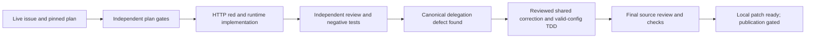

# Issue 26 local implementation ledger

Status: Local source implementation complete; publication, live acceptance and release pending.

## Authority and provenance

The [owner amendment](owner-development-amendment-2026-10-26.md) supersedes the historical #17 start gate only. Technical decisions follow [ADR 0008](../adr/0008-r2-authority-and-history.md), reviewed #24 schema8 and #25 credential lifecycle. The owner delegates engineering choices and requires issue-scoped stacked PRs without merging. Publication is separately gated by predecessor reconciliation.

Live issue #26 and comments were read on 2026-10-27. The [retained plan](issue-026.md) is the exact published v3 file from `45a32b6f33d10b2e7a3b6fb1aef19a3b4c09c295`; its obsolete start-gate and source-gap descriptions are historical, not current assertions. Local independent `--no-hardlinks` clone starts at #25 synthetic HEAD `551a064970fb6c434bc717225cc1d74876c3d76f`, tree `8a3f357c7591411a87a203950f5f33f691ddbcc0`. Origin is removed. This is not remote ancestry. Preserve published #26 branch history when publication becomes authorized.

## Plan validation and design

Use installed AgentKit `ak-vibe` feature route, reused plan with validation/red-team, `ak-cook --tdd --auto`, independent review, tests and docs. No `--ship`, `--both`, merge or remote write. Prior explicit delegation resolves routine technical questions without repeated approval requests. Research is scoped to existing pinned Workers/SQLite behavior and real runtime experiments; no dependency changes.

- Reuse the one synchronous transaction wrapper and schema8 runtime table. No second identity registry or session authority.
- Keep `ActorContext.runtimeId` null; return separate transaction-local `VerifiedRuntime` after checking current actor, exact credential/agent/workspace/epoch, active runtime and trusted presence deadline.
- Prepare opaque 256-bit proof and hash before SQL, after HTTP admission capture. Store only hash; first-response closure reveals proof only after successful first execution. Replay remains sanitized.
- Enrollment idempotency uses the existing stable operation target. Because principal is agent ID, replay must recheck original runtime's exact issuing credential and current lifecycle/deadline, never the newly generated proof.
- Hash incoming `X-Runtime-Token` during router preparation, not before admission capture. Heartbeat checks proof before replay lookup; expected version applies only to first mutation. Presence advances from trusted transaction time by 90 seconds; no run/task/fence/lease writes.
- Only createRuntime and heartbeatRuntime become available. No runtime-list, task, R3 or proof recovery route. Event production remains closed and runtime event visibility fails closed until its owner supplies policy.

## Bounded implementation sequence

1. Genuine HTTP red; enrollment/proof/heartbeat domain and ingress; focused duplicate, replay, expiry and exact binding tests.
2. Expanded race/restart/response-loss/no-secret and unrelated-state tests; independent review/fixes; aggregate checks and current docs.

## Initial evidence

`npm run test:workers -- test/runtimes/proof-lifecycle.test.ts`: exit 1, one collected test fails because unavailable enrollment returns 404 instead of 201. No product pass claimed. Node 24.22.1 / task-local npm 11.19.1. Dependency lock unchanged; 4,136 copied installed files verified byte-identical and separate inodes, with internal symlinks only. Generated Vitest result cache is excluded from dependency-input comparison after the red test rewrote it; no installed package file is excluded.

## Independent gates and resolved findings

Two independent plan reviewers checked actual source and the published contract. Their overlapping findings required exact-credential enrollment replay, proof-before-replay with first-mutation-only version checks, hashing after admission capture, and historical-plan reconciliation. All were accepted into the implementation above. Four adversarial lenses were covered by one reviewer plus a separate security reviewer; this is not a claim of four separate reviewers. Necessary audit-event and historical unavailable-route test ownership was added to the planned files.

Independent code review initially found no Critical/Important source defect. It then found two Important test defects: an unprefixed idempotency operation filter made a no-write assertion vacuous; and the wrong-proof test needed a previously successful heartbeat's same replay key. Corrected to the real persisted namespace/full-table snapshots and wrong/missing-proof replay with unchanged tables. Minor log coverage now includes `console.info`; HTTP docs explicitly distinguish human identity management from native enrollment. A read-only simplicity review retained the small existing-wrapper design without redundant registries or abstractions.

## Verification history and scope

- Initial focused Workers red: 1 test, unavailable enrollment 404 versus required 201.
- Initial feature green: 1 test. Expanded lifecycle first run: 3 passed / 1 failed because synthetic object name contained a disallowed double hyphen; corrected fixture name, then 4 passed.
- Independent race/restart suite initially 12 passed; later added four dynamic issuer ceiling/revocation cases and forged runtime-actor denial. Only the later combined run covers these additions.
- Initial aggregate: generated/type/contract checks and 798 Node tests passed; Workers 539 passed / 4 failed. Failures were stale historical unavailable-route expectations for newly implemented runtimes plus an invalid synthetic human deployment scope. Reconciled tests retain valid request bodies, exact denial categories and unchanged SQL snapshots; no authentication or no-write assertion was removed. The human-lane test explicitly uses an overbroad synthetic internal grant to test defense in depth.
- Reviewed focused runtime + R1 isolation run: 67 passed across 3 files, including 22 runtime tests. Full aggregate is rerun after the final remaining unavailable-route ownership correction.
- Documentation and historical-plan validators passed. Initial new-document status wording failed the baseline-status parser; corrected wording explicitly states pending acceptance, without weakening the validator.

Conditional workflow dispositions: research/comparison and actual Workers race experiments performed ([study](../research/r2-runtime-proof.md)); no speculative throughput benchmark. Debug used only to diagnose observed test failures. Test creation/review performed for changed observable security boundaries. Current docs and ADR updated locally because remote shipping is gated. No remote CI, browser UI run, deployment, current schema8 restore, credentials or release operation is claimed. The known host protected-output recovery CLI constraint must be reported separately if reproduced by the final aggregate; never bypass it.

## Material integration defect and reviewed prerequisite correction

Before completion, a canonical configuration check exposed a real #20/#25 integration blocker: native-only scopes cannot appear in the human executable scope enum, but dynamic credential issuance/current eligibility demanded a subset of that enum. The initial four dynamic SQL-fixture tests were therefore not supported end-to-end evidence. Completion was paused, the controller reported the gap, and independent reviewers compared separate delegation metadata, executable-scope widening and implied delegation. The owner-delegated root selected separate optional `delegable_native_scopes`, retained in existing authoritative configuration JSON, with exact-list/empty/omitted semantics described in [ADR 0008](../adr/0008-r2-authority-and-history.md).

This is an explicit prerequisite authority correction carried in #26. It changes the operator deployment schema and generated validation/types, not native public DTOs, SQL schema8, the table registry or executable human scopes. It touches all six consumers: issuance, current native/background eligibility, credential list filtering, metadata/revoke access, original replay visibility and credential audit visibility. No hidden default, wildcard, new registry, migration or live configuration change is introduced. The current relational grant can only narrow configured authority, including projects. Omitted optional fields are not normalized, preserving old canonical bytes/digest. Field addition/change/removal remains subject to configuration epoch/digest rules; deleting the field restores legacy delegation fallback and is not revocation.

Contract TDD collected 10 tests: one meaningful failure accepting the new explicit field, nine invalid-input passes; then all 10 passed. Independent integration TDD collected 20 tests with 7 behavior failures/13 passes before consumers were corrected; actual canonical configuration accepted but dynamic issuance failed and explicit-empty semantics were wrong. Earlier syntax/status/parameterization mistakes were test-authoring failures and are not advertised as behavior red. Independent consumer tests passed 15/15 after integration; canonical human login/issuance/enrollment and race tests passed 20/20. Combined identity/runtime regression then passed 74/74. Six existing identity test files now use an explicitly installed identity-management fixture instead of pretending that broader relational rows override narrower installed operator policy. No security predicate was weakened for fixtures.

Additional checks exercise all four native-only delegation scopes without adding any human executable scope; same-epoch config-field edit/removal must still raise `EPOCH_CONFLICT`; the existing synchronous restore-authority-overlay primitive revokes issued credentials/runtime proof while retaining current configuration. An initial expected RPC rejection emitted two unhandled Workers harness errors despite five assertions passing, so it is recorded as a failed run. The conflict assertions were moved inside the actual Workers transaction primitive without suppressing errors or changing expected results. This primitive test does not claim operational schema8 recovery acceptance. All final aggregate evidence must be refreshed after this correction.

Canonical OpenAPI credential descriptions were then corrected to describe the exact delegation ceiling rather than the obsolete executable-human-scope subset. The deployment schema is also embedded in generated operator contracts: the first post-correction aggregate failed immediately at `verify:generated` with `Stale operator contract`. Supported config/auth/operator generators were run; generated verification then passed. No validator was bypassed. An independent reviewer ran 21 focused tests while the aggregate was believed active; the aggregate had actually terminated before Workers at that generated gate, so there was no concurrent aggregate Workers process. No timing/performance inference is made from that reviewer run. A fresh full aggregate follows all generated/spec/test changes.

The separate independent delegation source review closed with no remaining blocking findings. It inspected all six consumer families, installed-config/current-row binding, no across-await cache, atomic install/digest/epoch semantics and restore-overlay ownership. Its Important canonical-description finding was resolved, and it independently verified generated outputs plus 21 Workers tests across the delegation consumer/integration suites. Its final 29-file source/spec/test manifest SHA-256 is `362019c7399177b97bf10a74c8d08e1e71aa02e03c99f16d836ec56ae52b1b30`; receipt SHA-256 is `0719b8991351e6a966cf343d029cbf0a050317e0bdc4babfaff929460d5b97b8`. This supersedes the earlier narrow runtime review for changed authority consumers, not its immutable history. No whole-product security or live acceptance claim follows.

## Final source verification and disposition

Node 24.22.1, npm 11.19.1, unchanged lock SHA-256 `8fa7894880bd0b77bfdf6fffe7e13fd8eb1a8b695b1316682dc33f7783873634`; isolated config/cache/data/state, metrics disabled. Final production/spec/test inputs match the independent 29-file review manifest above.

| Actual command/check | Observed result |
| --- | --- |
| `npm run check` | **Exit 1**, not an aggregate pass; only final recovery CLI stage failed as detailed below |
| `npm run verify:generated` (aggregate) | Passed config/auth/operator generated consistency |
| `npm run typecheck` (aggregate) | Passed all five TypeScript configurations |
| `npm run verify:r1-contract` (aggregate) | Passed route/grant/conflict contract checks |
| `npm test` (aggregate) | 809 passed, 30 files |
| `npm run test:workers` (aggregate) | 568 passed, 38 files, no unhandled errors |
| `npm run test:operator` (aggregate) | 18 passed, 2 files |
| `npm run test:deployment-verifier` (aggregate) | 13 passed |
| `npm run test:recovery-cli` (aggregate) | 8 passed / 18 failed; host protected-output restriction |
| `npm run build:ui` | Passed; R1 UI build only, no browser acceptance |
| `npm run check:runtime` | Passed local isolated Workers boot, liveness contract, schema8 and empty-authority denial |
| Documentation / historical-plan validators | Passed; no product acceptance inferred |
| `git diff --check` | Passed |

Recovery CLI failures reproduce the existing host `/tmp/.git` ancestor restriction (`RECOVERY_INPUT_REJECTED` in the protected-output guard), including the smoke fixture failing before its intended schema8 denial. The marker, guard, assertions, permissions and environment protections were not changed. Current schema8 operational recovery remains unavailable until #39/#43; historical schema7 checks and the synchronous overlay primitive do not establish its acceptance. Remote CI, browser UI execution, live ingress, production credentials/provisioning, deployed recovery and release were not run. No remote write, PR, merge or auto-merge was performed.

Final local commit/patch, exact HEAD/tree and log hashes are recorded in the external task manifest to avoid circular self-hashes. The predecessor remained clean at its original HEAD/tree. Next action is root-controlled remote predecessor reconciliation and publication; preserve original #26 plan branch history and stack on the actual predecessor PR. This local synthetic ancestry is not a publication claim.

