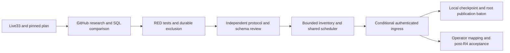

# Issue33 local execution — artifact cleanup exclusion

Status: Local source checkpoint with independent scoped review; live acceptance and environment-blocked checks pending. No remote publication, merge, deployment, provisioning or live acceptance from this task.

## Intake and authorized scope

Read live [issue33](https://github.com/trungtaottn/cf-agent-hub/issues/33), its corrected pinned plan at `456d8168d813bc513573e68348014f6c5d5b5594`, and immutable predecessor32 `46f53258936a3a954bb82097625a13296da3e25a` / tree `a74b19726ade3fecc87e20d028a919ad8f92b90e`. Created an isolated no-hardlink, no-remote clone. User explicitly authorized autonomous local research/comparison/TDD/review/docs, stacked publication by root without merge, and deferred integrated live acceptance until afterR4. That amendment supersedes the historical implementation start gate, not acceptance or deployment authority.

Used installed AgentKit `ak-vibe1.4.1`/CLI2.19.0, native research, validated/red-teamed plan, cook-TDD, independent code/storage review and journal. User shorthand `ak-vibecode` is not an installed alias. Publication/PR review/merge stages are root-owned and not executed here. The router's status.py was unavailable through its locator/safe filesystem search; installed files/CLI were independently inspected, with no hooks-active claim.

## Mechanism and scope boundaries

- Expire bounded indexed candidates in SQL, preserving original deadline while separately deferring retained anomalies. Tombstone, sanitized event and scheduler marker are atomic. Original-principal authority cannot revive an expired intent.
- Delete only proven canonical generation-qualified keys after whole-artifact exclusion or definitive commitment of a different generation. Protect selected/committed generation identities regardless of current references; protect malformed uncommitted retained result/message/checkpoint references.
- Keep original put admission immutable. A fresh delete reservation binds its own current epoch/maintenance generation and exact operation slot. Reserved puts can be cancelled only after permanent exclusion. Unknown in-flight/uncertain effects are never overwritten or promoted based on reads, timeouts, restart or re-delete.
- Persist terminal callback evidence with exact CAS, including after maintenance closes. Current completion/resume waits for unresolved effects; frozen contiguous schema7 alone retains historical no-artifact policy.
- Inventory one bounded server-owned workspace-prefix page, persistent cursor/generation CAS and saturating observation counters. Unknown keys are quarantined observations, never delete authority. Any retained capture/restore job causes a conservative coverage hold until39/43 produces exact immutable inventory.
- Reuse the existing shared alarm, independent budgets and catalog repair. Bound work initializes inventory without a new stage and survives eviction. No second scheduler, client cleanup command, public object key or recovery activation.

Forward schema13 is necessity-reviewed: fair artifact expiry scheduling, generation cleanup due/error, separate delete fences, one inventory evidence row and indexed seeks. Original migrations1–12 and frozen V1/schema8 evidence remain unchanged. Default/dev have no product bucket; conditional Worker/DO registration requires an explicit distinct trusted binding. Runtime catches direct alias; `verify:artifact-bindings` rejects same declared physical/preview names in CI. Opaque handles cannot independently attest physical mapping. Operator deployment verification remains separate.

## Live acceptance criteria mapped to local evidence

| Issue33 criterion | Implemented proof / explicit boundary |
| --- | --- |
| Tombstone-first / commit-first | Both real SQL/R2 orderings, suspended commit GET, late upload and exact committed-byte checks in cleanup-race and cleanup-invariants |
| Reservation / put / selection / delete restart | Reserved put/delete crashes, physical delete before SQL drain, eviction and stale-slot CAS; existing32 admission tests retain selection/put crash coverage |
| Delete failure remains due | Rejection persists DELETE_UNCERTAIN and retry due; the due retry observes a hold, not an unsafe new destructive call. Only original terminal evidence can drain |
| Bounded resumable inventory | Strict1–200, server-owned4096-byte cursor, persistent progress, overlap/fence CAS, startup without new stages; unknown objects never become delete authority |
| Retained result and JSON input | Committed exact pointers and retained accepted-result/synthetic proposal-input fixtures survive. No35/R3 runtime is implemented |
| Drain before complete capture | Shared maintenance completion/resume refuses unresolved effects; delayed original delete completion releases the exact slot. Actual current-schema capture is still closed and must be repeated by39/43 |
| Shared alarm without starvation | Independent bounded artifact/lease/notification sources, bucket-failure notification test, earliest due and post-cancellation inventory alarm |
| Composed32/33 review before writes | Independent protocol and ingress review leaves0 Critical/Important; conditional source routes now enabled under separate trusted binding, absent/alias/mismatch fail closed. No live deployment acceptance |

## Research, comparison and measured work

[Research record](../research/r2-artifact-cleanup.md) compares Docker Distribution stop-the-world mark/sweep, bucket lifecycle/blind scans and SQL-authoritative tombstone/CAS. The latter preserves online admission and existing maintenance semantics. Inference from the documented R2 consistency contract: a negative read describes observed completed state, not terminal completion of an earlier ambiguous write.

Independent review found an important performance flaw in the first implementation: LIMIT1 over1000 retained intents read6030 SQL rows. Tests reproduced it RED before adding durable expiry_check_at and reverse-reference indexes. The same production function now asserts at most128 observed SQL reads; original expires_at stays unchanged. Structural plans have no temporary ordering B-tree. These are local query-work measurements, not remote latency or total native memory claims.

## Verification ledger and review

Targeted actual Workers evidence includes both expiry/commit orderings, suspended commit GET, late generationA versus committedB, reserved put/delete crashes, deletion→SQL-drain crash, restart, stale terminal CAS, true delayed delete before maintenance completion, unknown outcomes despite missing bytes, retained accepted-result/synthetic JSON-input evidence, bounded inventory cursor and overlapping/maintenance responses, independent notifications and trusted ingress. Fixtures for retained results/inputs do not implement35 or R3.

Final source verification passed1074/1074 Workers tests across81 files,818/818 Node tests,18/18 operator tests and13/13 deployment-verifier tests. Five TypeScript projects, generated freshness, static bucket declarations, R1 contract, UI build and isolated schema13 runtime boot passed. Documentation and636 planning checks passed; audit reported0 vulnerabilities on the unchanged lock. Dependency copy4136 files was independently hash/inode/symlink verified, not a fresh npm ci. Workers SQL used task-owned TMPDIR; recovery CLI retained default/tmp.

Independent storage owner verified upgrade/rollback/restart, malformed legacy values, strict constraints, exact registry and unsupported/gapped policy,18/18. Independent protocol owner ran56/56 then23/23 ingress/HTTP/scheduler tests and4/4 binding tests; no Critical/Important remains in composed protocol after documented fixes. Source hashes match the review receipts. Final logs, exact commands, hashes and scoped receipts live in the external checkpoint manifest.

The first aggregate run had51 failures/1002 passes; the second had9 failures/1065 passes from exposure/alarm consumers. Corrections preserve old-R1 grant denial, exact unchanged SQL snapshots and future R3 route unavailability. Final1074-pass run includes those corrections. Deliberately cancelled/short stream fixtures retain workerd disconnected diagnostics; no final Vitest failure or unhandled-error summary. These logs are not described as pristine transport logs.

Known environment boundaries remain: recovery CLI default `/tmp` fixtures hit a protected `/tmp/.git` outside-checkout guard; pinned Chromium is absent. No guard/marker bypass, fixture relocation, assertion weakening or substitute browser is authorized. Actual current CLI result is8pass/18fail (exit1). Browser collected34 tests; attempted launch failed before assertions (1fixture failure,33did not run). Source unit tests do not make the aggregate or live acceptance green.

The canonical matrix retains R2 `Specified` until the separately reviewed R2 evidence-register amendment, as for preceding local R2 issues. This planning-status boundary does not negate the implemented conditional source or claim it is Verified/Released. The existing plan validator and formal register were not relaxed.

## Remaining ownership

- Root reconciles immutable local checkpoint with the actual published predecessor ancestry before any stacked PR. No remote writes here; no merge.
- Operator owns explicit separate private product mapping, real deployment verification and laterR4 integrated acceptance. No resource or credential was provisioned.
-39/43 own current-schema capture/restore, exact generation wire identity/inventory, scheduling/authority invalidation, drain-before-checkpoint and complete-byte acceptance. Unknown operation completion may remain an intentional hold until independently proven; no automatic convergence promise or unsafe drain override.

