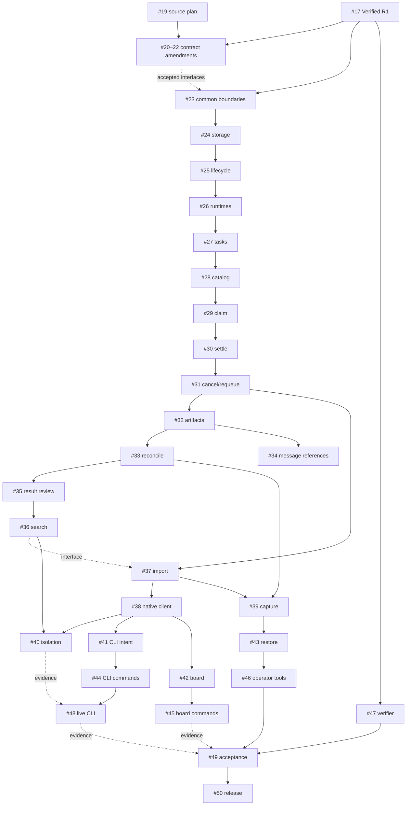

# R2 Execution Plan and Dependency DAG

Status: Execution pending; source planning does not satisfy R1 acceptance or owner authorization.

## Goal and finish condition

Deliver canonical F11–F26, F29, F34 and F40 through one authority model; finish only when #49 records exact-candidate real multi-agent/isolation/CLI/recovery evidence and #50 performs its separately authorized release handoff. A merged plan is not that finish condition.

## Edge semantics

**Hard** blocks starting implementation. **Interface** requires producer contract frozen before consuming it; implementation can overlap only with disjoint ownership and accepted signatures. **Evidence** blocks verification/release even if source exists. No parent/epic links count as dependencies. No follow-on hardening edge currently replaces a required R2 child.

The full authoritative typed graph is `research/issue-graph.json` and the complete edge table in [decomposition](issue-decomposition.md). This condensed diagram shows hard order; see the table for all interface/evidence edges.

## Waves and assignment boundaries

Waves below are conservative integration batches, not permission to skip table edges. Tasks in one wave only run concurrently if all hard dependencies from earlier waves and interface freezes are satisfied. Stop after one or two bounded task deliveries per execution session, following AGENTS.

| Wave | Work | Safe parallelism / integration gate |
| --- | --- | --- |
| P | #19 source plan | Authorized planning only now; independent review and final accepted-R1 drift check |
| 0 | #17 external predecessor | R1 owner resolves #11/#10/#14–18; no R2 implementation during this wave |
| 1 | #20,#21,#22 | Research/drafts disjoint; serialize OpenAPI/docs/schema integration through #23 owner |
| 2 | #23 then #24 | Common contract/generator/runner freeze, then sole migration and registry owner |
| 3 | #25 then #26 then #27 then #28 | Identity/credential/runtime/task/catalog authority chain; no speculative merges |
| 4 | #29 then #30 then #31 | Claim unavailable until safe expiry/failure/cancel integration complete |
| 5 | #32 then #33; #34 after #32 | Bytes route exposure waits cleanup integration; #33/#34 disjoint domain files, shared router serialized |
| 6 | #35 then #36; #37 after #31 and import/search interface freeze | Import may proceed after accepted search interface without pretending full isolation passed |
| 7 | #38 and #39 after prerequisites | Client facade vs capture have disjoint owners; registry/schema changes prohibited without #24 coordination |
| 8 | #40,#41,#42,#43; #47 after frozen #22/#38 interfaces | Isolation, CLI journal, read-only board, restore and verifier can overlap only with shared-file locks |
| 9 | #44,#45,#46 | CLI commands, board commands and operator tooling, each consumes its reviewed predecessor |
| 10 | #48 then #49 | Authorized isolated target, exact immutable candidate, all evidence joins; no fixture substitution |
| 11 | #50 | Explicit release action authority; no automatic tag/deploy/merge |

## Shared-file ownership and conflict rules

| Shared surface | Integration owner | Producers / required coordination |
| --- | --- | --- |
| OpenAPI, canonical scope schemas, examples fixture map, generated DTOs | #23, after #20–22 reviewed drafts | Domain changes request exact additions; never hand-edit generated output |
| migrations.ts, schema-version.ts, migration0008, table-registry | #24 | Every domain supplies table/columns/index/FK/restore semantics before migration freeze |
| bootstrap authority, auth context/authorize, static_agents canonical registry | #24 storage + #25 lifecycle sequenced | #20/#22 approve dynamic provenance semantics; #26/#43 consume |
| workspace-do/router/r2-routes/events/cursor operation union/test runner configs | #23 integration owner | Domain PRs deliver narrow dispatch/visibility hooks; serialized integration, no broad resource fallback |
| OutboxScheduler and alarm nextDue integration | #30 | #29 lease deadlines/#33 artifact cleanup/#39 maintenance; no second alarm scheduler |
| Product artifact binding, WorkspaceEnvironment/wrangler types | #32 with #22 frozen binding map | #39/#43 consume; real provisioning not part of source task |
| client.ts/types.ts/native-client.ts | #38 | #41/#44/#42/#45 consume; transport auth retries controlled centrally |
| recovery/protocol/manifests/jobs/controls | #39 then #43 | #22 contract, #24 registry; #46 no replacement protocol |
| package.json/generated outputs/whole suites | designated integration agent per wave | Never concurrent regenerate/build/full-suite writes |

Use isolated branches/worktrees. A second owner needing the same file supplies a patch proposal to its current owner, waits for integration and rebases; do not concurrently edit the same checkout. Before each commit re-read current diff, reject unrelated changes, stage exact paths. External branch updates never force-push or overwrite another agent.

## Verification and evidence contracts

Every implementation task runs named failing cases first, confirms the failure concerns the intended behavior (not missing runner/import), implements minimally, runs focused nonzero collection then relevant aggregate checks. Use locked tools; no dependency upgrades to make a plan command work. #23 must add missing runtime include patterns before dependent tests; no --passWithNoTests.

Evidence records exact source/tree/lock digest, runtime versions, command, exit, count, observed assertions, independent reviewer and pending limitations. Mock/local tests prove source behavior only. #40 current-authority isolation, #48 real isolated HTTPS CLI, #39/#43 real full-state recovery and #47 accepted verifier are mandatory joins at #49. Historical R1 receipts retain their original SHAs.

## Branch-per-task publication and future pickup

User authorized32 plan-only branches `docs/r2-019-plan` through `docs/r2-050-plan`, one existing issue each, plus corresponding comments. No32 PRs are implied. All share the same immutable base, not sibling plan commits. Each carries its task-only file and the minimum common contract/index/decision context. Publication manifest pins payload hashes and issue dependencies.

These are **planning branches**, not an instruction to implement directly on an obsolete base. At runtime pickup, start from then-current accepted dev; integrate all hard predecessors, verify contract hashes/current issues, bring in the task plan and re-review source drift. Do not cherry-pick an entire planning sibling's runtime assumptions without checking its accepted implementation. R1 acceptance and proposal decisions remain blocked regardless of branch availability.

## Agent handoff prompt

“Read AGENTS, current issue #N, task plan and common R2 handoff. Report actual base/HEAD, hard/interface/evidence gates and proposed decisions before edits. If #17 or any hard gate is unmet, stop with blocked evidence; do not implement. Once authorized and ready, implement only issue #N, use its TDD steps, exact files and current common interfaces, and stop after one or two bounded subtasks for independent review. Never mutate issue labels/body, provision/deploy, release or merge without explicit authority. Return exact commit, commands/counts/receipts, scope diff, reviewer findings and remaining gates.”

## Release/readiness gate

All runtime children remain blocked now. #19 is available as owner-directed planning only and still needs independent amendment review/integration. “Agent-readable” is not “ready to cook”. There is no safe automatically executable runtime queue until #17 and the recorded prerequisites are satisfied.
