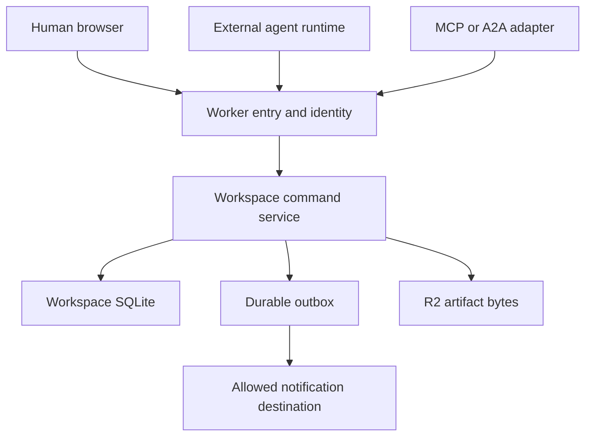

# System architecture

Status: Design baseline · Contract revision 0.1 · Implementation pending.

CF Agent Hub coordinates durable work within an explicitly selected workspace. It accepts authenticated commands, owns task state and records decisions; external runtimes execute the work. The proposed deployment uses Cloudflare Workers for entry and identity validation, one Durable Object with SQLite per workspace for coordinated state, and R2 for artifact bytes.

## Boundaries and authority

The command service and its SQLite/outbox state are owned by the workspace Durable Object. The diagram groups their responsibilities; it does not imply a separate shared database service. External destinations receive notifications after transaction commit. They do not participate in the local SQL transaction.

| Boundary | Owns | Must not decide |
| --- | --- | --- |
| Worker entry | Request bounds, verified human/native identity, route selection, error envelope | Task completion from an HTTP status alone |
| Workspace command service | Membership/grants, policy, state transitions, claims, versions and idempotency | Whether an untrusted model statement is authorization |
| Workspace SQLite | Durable domain records, events, outbox and command outcomes | External tool completion without a reported and reviewed result |
| R2 | Artifact bytes at opaque server-owned object keys | Workspace membership or task state |
| External runtime | Tool execution, local process lifecycle and external action reconciliation | Server-owned task state or human approval |
| Browser and protocol adapters | Intent translation and presentation | New permissions, independent business rules or optimistic final state |

Cloudflare describes Durable Objects as coordinated entities with attached storage and recommends choosing boundaries around the entity being coordinated. A workspace is our chosen boundary because task claims, participants and policy must be checked together. This is an application design choice, not a platform claim that every possible workspace fits one object. See [Cloudflare guidance](https://developers.cloudflare.com/durable-objects/best-practices/rules-of-durable-objects/) and [ADR 0001](adr/0001-workspace-authority.md).

## Workspace routing and isolation

The operator provisions a workspace catalog in deployment configuration. Each public workspace ID maps to one stable Durable Object identity. A caller cannot select an arbitrary object name, Cloudflare account or bucket prefix. Profile import cannot edit the catalog or change the mapping. Initial releases do not provide automatic tenant provisioning or a global workspace directory.

Authentication at the Worker is necessary but insufficient. Every domain command checks that the authenticated actor has a current membership or grant in the routed workspace. Cross-workspace resource IDs must fail before content is returned or mutated. Cache keys, cursors, idempotency records and artifact access checks include the workspace boundary. Team invitations, when implemented, add memberships to existing operator-provisioned workspaces.

## Command and read paths

A mutation validates the request shape and byte limits, resolves the actor, checks policy, reads current versions, and applies one domain command. Within a local SQL transaction it writes state changes, an append-only audit event, any outbox records and the command's idempotency outcome. Only after commit may a dispatcher perform a webhook delivery. A rolled-back command must expose none of these partial effects.

Reads are scoped to the same workspace and actor. Lists use bounded opaque cursors and stable ordering. UI caches are projections; a stale board cannot authorize a drag or prove that a run owns a task. Mutations return authoritative versions and the UI refreshes or reconciles the affected projections. Event consumption may invalidate projections but must not replay state transitions by interpreting arbitrary event text.

Cloudflare's storage API provides transactional operations within a Durable Object. The implementation must use the current documented transaction semantics and must not infer a distributed transaction with R2 or external services. [SQLite storage documentation](https://developers.cloudflare.com/durable-objects/api/sqlite-storage-api/) is the platform reference.

## Artifact path

Artifacts have a staged metadata record, a bounded upload, and an explicit commit after size, digest and access checks. Only committed artifacts can be attached to a result. Download authorization is evaluated against workspace access, even if the caller already knows an artifact ID. R2 keys are server-owned and must not contain an untrusted filesystem path.

A crash between an R2 write and metadata commit leaves a recoverable intermediate state, not a successful result. Reconciliation can complete a verified upload or remove an unreferenced object after the configured retention window. Cleanup must first atomically exclude the expired intent from future upload/commit, then delete its exact object key; a late in-flight write remains an orphan to reconcile. An existence check followed by deletion without this exclusion is unsafe. A SQL rollback cannot undo an already written R2 object. [Backup and restore](backup-restore.md) specifies the reconciliation evidence required after recovery.

## Schedulers and recovery

The workspace stores all due work in durable tables: expiring leases, proposal deadlines, notification retries and artifact cleanup. One scheduled alarm processes bounded batches and schedules the next due item. Alarm callbacks are idempotent and tolerate repeated execution. External calls must not hold a long-running SQL transaction.

Fresh requests independently check deadlines. Correctness must not depend on an alarm firing at an exact wall-clock instant. Scheduler lag may delay a cleanup or notification, but it must not extend an expired run's authority or auto-approve a decision. [Operations](operations.md) covers visibility into queue age, retries and dead letters.

## Scaling and deliberate exclusions

Workspaces are independent coordination domains. A busy workspace can become a hot object; its execution workload remains outside the hub, but its command rate, message volume and history still require measurement and retention policy. Do not shard a workspace until evidence justifies the additional distributed coordination. No throughput target is promised in this baseline.

The hub does not include a code sandbox, model hosting, arbitrary network proxy, unattended human approvals, organization billing or automatic account provisioning. Adapters may provide external capabilities only through explicit grants and a documented connector contract. MCP session presence is not a background execution scheduler.

## Architecture acceptance

The first implementation must demonstrate cross-workspace denial, atomic state/event/outbox outcomes, restart-safe due-work scheduling, independent runtime fencing, artifact orphan recovery, truthful projections and restoration from a coordinated backup manifest. Source layout may change; these boundaries and acceptance requirements may not change silently. See [testing](testing.md), [security model](security-model.md) and the [feature matrix](feature-matrix.md).
