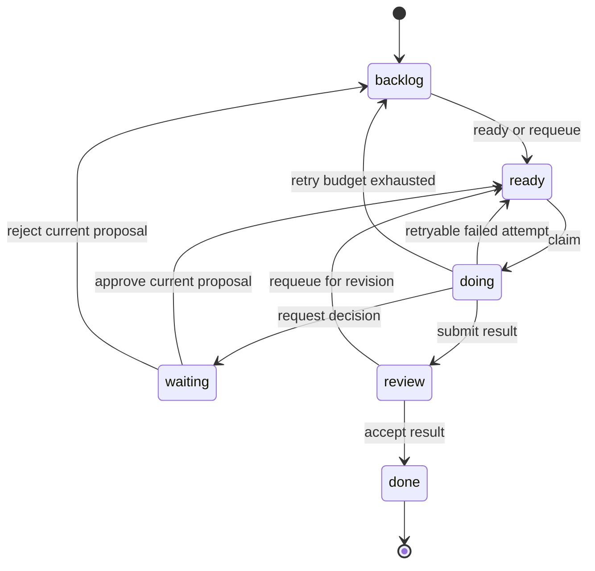

# Task lifecycle

Status: Design baseline · Contract revision 0.1 · Implementation pending.

This is the canonical proposed state machine. A task represents a durable unit of work and its review outcome. A run represents one execution attempt. A notification or ACK represents message delivery. These objects have independent lifecycles and must never substitute for one another.

## States and board meaning

| State | Meaning | Execution authority |
| --- | --- | --- |
| `backlog` | Work is captured but not eligible for a claim | None |
| `ready` | The task is eligible under its current assignment and policy | None until an atomic claim succeeds |
| `doing` | One active run owns a valid lease | Bound agent and runtime only |
| `waiting` | A current proposal requires a human decision | No active execution lease |
| `review` | A submitted result awaits independent acceptance | No active execution lease |
| `done` | An authorized independent reviewer accepted the result | None; terminal |
| `cancelled` | An authorized actor ended the task without accepting a result | None; terminal and archived |

The visible Kanban has the first six columns. Cancelled tasks remain available in the archive and audit history. A filter or hidden column does not change these domain states.

Cancellation from any nonterminal state and expiry of a waiting proposal are defined in the table below rather than duplicated across the diagram.

## Authorized transitions

Every command validates the authenticated workspace, actor kind, relevant scope, current membership or credential, `expected_version`, and command-specific guards **inside** the domain transaction. Exact route names and bodies live in [HTTP API](http-api.md).

| Command or system event | From → to | Additional conditions and effects |
| --- | --- | --- |
| Create | New → `backlog` | Validate references and create server-owned versions/timestamps; never create an active run |
| Ready | `backlog` → `ready` | `tasks:schedule`; no uncertainty/exhaustion hold; valid active project/role and eligible assignment |
| Claim | `ready` → `doing` | `tasks:claim`; verified runtime proof, no uncertainty/exhaustion hold, active bound agent/runtime, assignment/capability eligibility and WIP capacity; atomically create lease and fence |
| Request decision | `doing` → `waiting` | Owning native actor with `tasks:execute`; checkpoint and decision proposal bound to a new `proposal_version`; end run as `paused` |
| Approve | `waiting` → `ready` | Human session with `approvals:decide`; exact current task/proposal version and authorized decision scope; next execution requires a new claim |
| Reject | `waiting` → `backlog` | Same human and version checks; decision reason recorded; no implicit rerun |
| Proposal expiry | `waiting` → `waiting` | Mark approval expired and expose an actionable flag; no automatic approval, rejection or execution |
| Submit result | `doing` → `review` | Owning native actor with `tasks:execute`; current fence and lease; committed, authorized artifact references; end run as `submitted` |
| Accept result | `review` → `done` | `tasks:review`; current result and version; reviewer must differ from both submitting principal and submitting agent |
| Fail or lease expiry | `doing` → `ready` or `backlog` | End run as `failed` or `expired`; retry only when outcome is known safe under policy and budget allows; otherwise flag Backlog. Expiry without trusted replay-safe classification creates an uncertainty hold |
| Requeue | `review` or `backlog` → `ready` | `tasks:schedule`; record revision reason; invalidate previous result/approval as current, preserve history; do not reset retry budget |
| Cancel | Any nonterminal → `cancelled` | `tasks:cancel`; invalidate active run and pending decisions; preserve audit and retained artifacts |

No generic PATCH may directly set state, active owner, run, fence, result or approval. Metadata PATCH is limited to Backlog and Ready, and is rejected while a current approved proposal authorizes the next execution. A changed title, description, project, work role or assignment could change the approved intent. Cancel and create revised work when that intent must change; a previous approval cannot authorize the revision. Review comments do not accept a result. The exact editable metadata and state restrictions are specified in the API contract.

## Claim, lease and fencing

A successful claim creates one run with `runtime_instance_id`, agent identity, lease deadline and an increasing task-scoped `fence`. The task points to that run through `active_run_id`. The authorization test is the conjunction of current run identity, actor binding, unexpired server-side lease and matching fence; possession of an old run ID is insufficient.

Runtime enrollment also issues a one-time opaque proof bound to the workspace, agent, runtime and issuing native credential. Execution mutations require that proof in addition to the active native credential. A readable runtime ID or fence is not a secret and cannot authenticate ownership. Revoking the issuing credential invalidates its runtime proof; rotation requires draining or reconciling old work and enrolling a fresh runtime rather than inheriting an active run. Exact headers and one-time-secret retry behavior are in the HTTP contract.

Two simultaneous claims must produce one winner. When two eligible tasks compete for the last available agent WIP slot, the same workspace transaction boundary must enforce that limit. A presentation layer cannot implement this guarantee.

Run heartbeats renew only an active, unexpired run and update `run_version`. They do not increment `task_version` or `proposal_version`, so ordinary renewal cannot invalidate a pending metadata read or a human decision. Renewing an already expired run is forbidden even if the expiry scheduler has not yet processed it. Claim, submit and approval commands perform due-time validation themselves.

Runs have statuses `active`, `paused`, `submitted`, `failed`, `expired` and `cancelled`. Every nonactive status ends the attempt and has `ended_at`; a paused run never resumes in place. A subsequent claim obtains a new run and fence.

## Decision integrity

A proposal includes the intended action, scope, exact input binding, checkpoint and expiry. Authorization-significant parameters are captured in a committed immutable JSON artifact whose ID and verified digest are bound to the proposal; a free-text summary is not the complete permission request. It is a specific permission request, not a general grant to an agent. `proposal_version` advances when a new proposal is issued. Approval records bind the human principal, task version, proposal version and decision contents. Any outdated decision is rejected with a conflict and requires a fresh read.

After approval the task becomes Ready. An approved action must still be checked against current workspace policy when the next run starts and when an external action is dispatched. Revocation or cancellation after approval must take effect; approval does not bypass authorization. Rejection returns the task to Backlog for an explicit revision. Expiry leaves it Waiting so the UI can show the unresolved decision honestly. An authorized scheduler can cancel a stranded waiting task and create revised work; this baseline does not provide an implicit expired-proposal renewal command.

## Failure and retry

`retry_limit` is a bounded count of additional execution attempts permitted by workspace policy; it is fixed for the task unless a later explicitly designed policy operation changes it. `retry_count` records consumed additional-attempt budget, not deliveries or heartbeats. The claim transaction records the applicable retry-safety policy decision in its audit evidence. Lease expiry is treated as an uncertain external outcome by default. Only an explicit, trusted workspace policy established before execution may classify the work as replay-safe (for example, a verified externally idempotent operation); bounded automatic retry is available only for that classification. A runtime cannot declare work safe after losing its lease. Once authority is lost it may read, reconcile and escalate, but cannot use a stale fail or submit command to change the old attempt. The server expiry transition applies the hold or safe retry.

A failure with uncertain external effects always returns Backlog with `outcome_unknown`, preserving the uncertainty for external reconciliation. Both `outcome_unknown` and `retry_exhausted` block Ready, Requeue and Claim. This baseline has no command that silently clears those holds; after documented external reconciliation, an authorized actor may create reviewed replacement work and link its provenance. After a known failed/expired attempt, if retry is allowed and `retry_count < retry_limit`, atomically increment `retry_count` and return Ready. Otherwise return Backlog with a structured exhaustion flag. Requeue does not erase this history or enlarge the budget. Manual scheduling after exhaustion requires a revised task or an explicit policy extension outside this baseline.

If a client loses the response to a claim or submit, it retries the same idempotency key and payload within the replay window. It must not create a fresh claim or repeat an external side effect merely because the response was lost. The hub fences its own state; an external tool must enforce its own operation identity or compensating/reconciliation workflow. See [delivery semantics](delivery-semantics.md).

## Acceptance scenarios

Required evidence includes simultaneous claims, WIP contention, a stale owner's submit after reassignment, heartbeat at the lease boundary, an old approval after a new proposal, rejection/expiry without execution, cancellation concurrent with submit, replay after a committed-but-lost response, retry exhaustion, and denied self-acceptance through a different credential belonging to the submitting agent. Assert persisted state, event, outbox and idempotency outcome together. A board screenshot alone cannot prove this contract.
